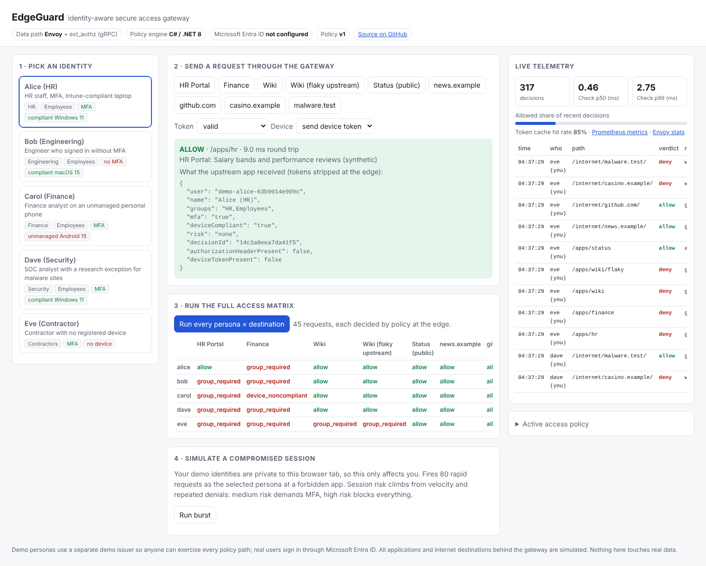
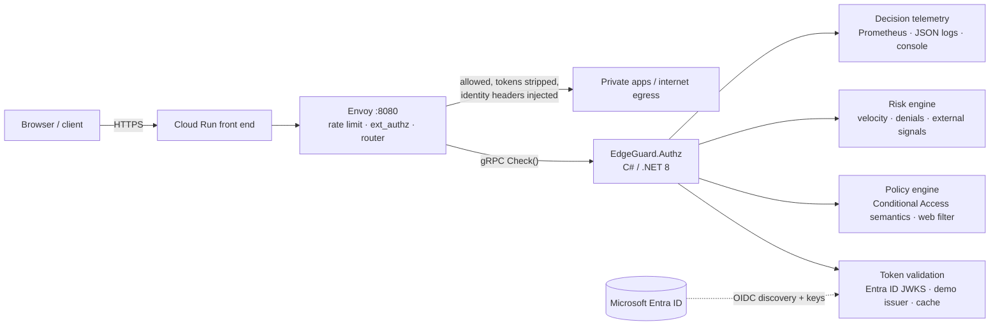

# EdgeGuard

**An identity-aware secure access gateway.** Envoy carries every request on the data path; before anything
reaches a private app or an internet destination, Envoy asks a C#/.NET authorization service, over gRPC,
whether *this identity, on this device, at this risk level* may proceed. It is a small, working model of
how a Zero Trust edge (Secure Web Gateway + private application access) makes per-request decisions.

**Live demo:** https://edgeguard-txtjkjjmia-uc.a.run.app (demo personas work for anyone; *Sign in with Microsoft Entra ID* works for accounts in the EdgeGuard tenant) · **Stack:** Envoy 1.33 · C# / .NET 8 · gRPC · Microsoft Entra ID · Docker · Google Cloud Run · GitHub Actions · k6



## What it does

| Capability | How |
|---|---|
| **Per-request authorization on the data path** | Envoy `ext_authz` filter calls `envoy.service.auth.v3.Authorization/Check` (gRPC, 250 ms budget). **Fails closed**: if the service cannot answer, the request is refused (503). |
| **Identity** | Validates **Microsoft Entra ID** access tokens (v1 and v2 issuers, tenant JWKS via OIDC discovery with automatic key-rollover refresh); app roles become groups; MFA read from `amr` or a Conditional Access authentication context. A separate demo issuer lets anyone try every policy path. |
| **Conditional Access-style policy** | Every policy whose assignment matches applies; any **block wins**; otherwise **every** grant control must hold (group, MFA, compliant device). Unmatched traffic is **denied by default**. Policies hot-reload; an invalid file is rejected and the last good one stays live. |
| **Web content filtering** | Internet traffic is categorized by FQDN suffix (label-aligned, so `notcasino.example` ≠ `casino.example`); blocked categories, per-group research exceptions; IP literals and malformed names rejected. |
| **Session risk and containment** | Request velocity and repeated denials raise risk: medium risk demands MFA, high risk blocks every app. Automation (or an analyst) can raise an identity's risk through an authenticated admin API to contain it instantly. |
| **Data path hygiene** | Credentials stop at the edge (`authorization` and device tokens are stripped before upstream); identity headers are **overwritten**, so a client cannot smuggle `x-eg-user: admin`; path normalization, slash merging, and escaped-slash rejection block `/apps/status/../hr`-style bypasses. |
| **Reliability** | Envoy retries on another attempt for 5xx/resets with backoff, circuit breakers, outlier detection, request/idle timeouts, ingress token-bucket rate limiting plus a tighter bucket on token minting. |
| **Telemetry** | One decision event feeds Prometheus metrics (`/metrics`), JSON decision logs, Envoy JSON access logs joined by decision ID, Envoy stats (`/envoy/stats`), optional OpenTelemetry traces (OTLP), and the live console. |

## Architecture



## Measured results

| Check | Result |
|---|---|
| Unit tests (policy, identity incl. Entra token shapes, risk) | **53 passing** |
| Black-box integration tests against the real container | **27 passing** locally and in CI; the same suite gates every Cloud Run rollout |
| Live deployment, Microsoft Entra ID | Tenant signing keys loaded at startup; forged-key and cross-tenant tokens rejected in production (`bad_signature`, `untrusted_issuer`) |
| Authorization overhead at 500 rps | **+0.7 ms p50** vs. Envoy alone (1.31 vs. 0.63 ms) |
| `Check` latency inside the service | **0.105 ms p50 / 0.178 ms p99** (token cache on) |
| Sustained load, 1.5 vCPU | **1,500 rps, 0 errors**, p99 39 ms |
| Flaky upstream (fails every other call) | **100%** of client requests succeed via Envoy retries |

Method, caveats and reproduction steps: [docs/benchmarks.md](docs/benchmarks.md). The load generator ran on
the same small machine as the gateway, so these are conservative.

## Try it

```bash
docker build -t edgeguard .                       # Envoy + authz in one image
docker run -p 8080:8080 -e EdgeGuard__AdminKey=dev edgeguard
open http://localhost:8080                         # console: personas, matrix, burst, live telemetry
```

Or from the command line:

```bash
TOKEN=$(curl -s -XPOST localhost:8080/api/demo/token -H 'content-type: application/json' -d '{"persona":"carol"}')
curl -s localhost:8080/apps/finance \
  -H "authorization: Bearer $(echo $TOKEN | jq -r .accessToken)" \
  -H "x-device-token: $(echo $TOKEN | jq -r .deviceToken)"
# {"decision":"deny","reason":"device_noncompliant","message":"Policy 'Finance Ledger: ...' requires a compliant device", ...}
```

| Persona | Signals | HR Portal | Finance | Wiki | casino.example | malware.test |
|---|---|---|---|---|---|---|
| Alice | HR, MFA, compliant | ✅ | group required | ✅ | blocked | blocked |
| Bob | Engineering, **no MFA** | group required | group required | ✅ | blocked | blocked |
| Carol | Finance, MFA, **unmanaged phone** | group required | **device noncompliant** | ✅ | blocked | blocked |
| Dave | Security, MFA | group required | group required | ✅ | blocked | ✅ research exception |
| Eve | Contractor, no device | group required | group required | group required | blocked | blocked |

## Tests and CI

```bash
dotnet test                                                   # unit
EDGEGUARD_URL=http://localhost:8080 EDGEGUARD_ADMIN_KEY=dev pytest -q tests/integration
docker run --rm --network host -v $PWD/loadtest:/s grafana/k6 run -e RATE=500 /s/k6.js
```

GitHub Actions builds the image, runs unit tests, starts the container, runs the integration suite, then a
k6 load smoke test that must stay error-free.

## Deploy (Google Cloud Run, verified rollout)

`deploy/cloudrun.sh` builds with Cloud Build, deploys the new revision **with 0% traffic** under a tag, runs
the full integration suite against that revision, and only then moves traffic to it; a failing revision
never serves users. Secrets (admin key, demo signing key) live in Secret Manager. To sign in with real
Microsoft Entra accounts, follow [docs/entra-setup.md](docs/entra-setup.md).

## Repository layout

```
src/EdgeGuard.Authz/    C# service: gRPC Check, identity, policy, risk, telemetry, console (wwwroot)
  Protos/               Envoy ext_authz v3 contract (wire-compatible subset)
  config/policy.json    access policy (hot-reloaded)
envoy/envoy.yaml        data path: listeners, filters, routes, clusters
tests/                  xUnit unit tests · pytest black-box integration tests
loadtest/k6.js          constant-arrival-rate load test
deploy/                 container entrypoint, Cloud Run verified-rollout script
```

## Design notes and limits

- **Why ext_authz and not a custom proxy?** Envoy already does the hard data-path work (HTTP/2, pooling,
  retries, outlier detection). Keeping authorization in a separate service lets policy change and scale
  independently, and it fails closed.
- **Why cache token validation?** RSA verification is the most expensive step per request; caching by token
  hash, capped at the token's own expiry, cut `Check` time about 25%.
- **Demo identities are per visitor.** Each browser session gets its own subject (`demo-alice-<session>`), so one
  visitor's burst never changes what another visitor sees. Per-identity risk windows are capped and idle ones evicted.
- **Entra keys load before traffic.** The first Entra request after a cold start used to fetch OIDC metadata inside
  Envoy's 250 ms authorization budget and fail closed; the service now loads the tenant's keys before it listens.
- **Risk state is per instance** (in memory). A multi-instance deployment would move it to a shared store;
  the demo runs a single Cloud Run instance.
- **Simulated pieces:** the private apps, internet destinations and device-compliance attestation are
  simulated; identity can be real (Entra ID) or demo.
